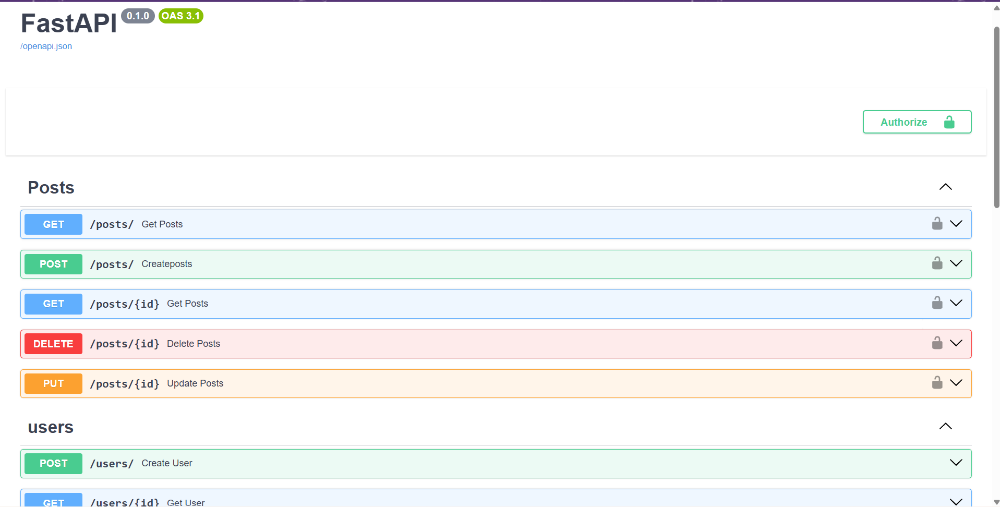

# Social Media API

A REST API built with **FastAPI** and **PostgreSQL** where users can sign up, log in, create posts and vote on posts. It uses JWT authentication, database migrations, automated tests and Docker.

**Live API docs:** https://fastapi-social-api-x0fy.onrender.com/docs
> Hosted on a free tier, so the first request after a period of inactivity can take up to a minute.



## Features

- User registration and login with **JWT** authentication
- Passwords hashed with **bcrypt**
- Full **CRUD** for posts, with owner-only update and delete
- **Voting** system: one vote per user per post (composite primary key)
- Post list with **search**, **pagination** (`limit`, `skip`) and **vote counts**
- Database schema managed with **Alembic** migrations
- Automated tests with **Pytest** (auth, posts, votes) using a separate test database
- **Docker** and **Docker Compose** setups for development and production

## Tech Stack

| Area | Tools |
|---|---|
| Language | Python 3.12 |
| Framework | FastAPI, Uvicorn |
| Database | PostgreSQL, SQLAlchemy |
| Migrations | Alembic |
| Validation | Pydantic v2 |
| Auth | JWT (python-jose), bcrypt (passlib) |
| Testing | Pytest |
| DevOps | Docker, Docker Compose |

## API Endpoints

| Method | Endpoint | Description | Auth |
|---|---|---|---|
| POST | `/users/` | Create a new user | No |
| GET | `/users/{id}` | Get a user by id | No |
| POST | `/login` | Log in and receive a JWT | No |
| GET | `/posts/` | List posts (`limit`, `skip`, `search`) with vote counts | Yes |
| POST | `/posts/` | Create a post | Yes |
| GET | `/posts/{id}` | Get one post with its vote count | Yes |
| PUT | `/posts/{id}` | Update your own post | Yes |
| DELETE | `/posts/{id}` | Delete your own post | Yes |
| POST | `/votes/` | Add (`dir: 1`) or remove (`dir: 0`) a vote | Yes |

Interactive documentation is available at `/docs` (Swagger UI) and `/redoc`.

## Project Structure

```
.
├── app/
│   ├── main.py          # App setup, CORS, routers
│   ├── config.py        # Settings loaded from environment variables
│   ├── database.py      # SQLAlchemy engine and session
│   ├── models.py        # Database tables
│   ├── schemas.py       # Pydantic request/response models
│   ├── oauth2.py        # JWT creation and verification
│   ├── utils.py         # Password hashing helpers
│   └── routers/         # auth, user, post, vote
├── alembic/             # Database migrations
├── tests/               # Pytest test suite
├── Dockerfile
├── docker-compose-dev.yml
├── docker-compose-prod.yml
└── requirements.txt
```

## Getting Started

### 1. Clone the repository

```bash
git clone https://github.com/YOUR_USERNAME/YOUR_REPO.git
cd YOUR_REPO
```

### 2. Create your `.env` file

Copy the example and fill in your own values:

```bash
cp .env.example .env
```

Generate a secret key:

```bash
python -c "import secrets; print(secrets.token_hex(32))"
```

Environment variables:

| Variable | Description |
|---|---|
| `DATABASE_HOSTNAME` | Database host (`localhost` when running on your machine) |
| `DATABASE_PORT` | Database port (`5433` with the dev compose file) |
| `DATABASE_USERNAME` | Database user |
| `DATABASE_PASSWORD` | Database password |
| `DATABASE_NAME` | Database name |
| `SECRET_KEY` | Secret used to sign JWT tokens |
| `ALGORITHM` | JWT algorithm, e.g. `HS256` |
| `ACCESS_TOKEN_EXPIRE_MINUTES` | Token lifetime in minutes |

### 3. Run with Docker

```bash
docker compose -f docker-compose-dev.yml up -d --build
docker compose -f docker-compose-dev.yml exec api alembic upgrade head
```

The API runs at http://localhost:8000 and the docs at http://localhost:8000/docs.

### 4. Run without Docker (optional)

```bash
python -m venv venv
venv\Scripts\activate          # Windows
# source venv/bin/activate     # macOS / Linux
pip install -r requirements.txt
alembic upgrade head
uvicorn app.main:app --reload
```

## Running the Tests

The tests use a separate database named `<DATABASE_NAME>_test`. Create it once:

```bash
docker compose -f docker-compose-dev.yml up -d postgres
docker compose -f docker-compose-dev.yml exec postgres createdb -U postgres fastapi_test
```

Then run:

```bash
pytest -v
```

## What I Learned

- Designing a REST API with proper status codes and authentication
- Using JWT tokens to protect routes and check resource ownership
- Managing database changes safely with Alembic migrations
- Writing automated tests with fixtures and a separate test database
- Containerizing an application with Docker and Docker Compose

## Roadmap

- [ ] CI/CD with GitHub Actions
- [ ] Deploy to a cloud platform
- [ ] Comments on posts
- [ ] Rate limiting on login

## License

MIT
